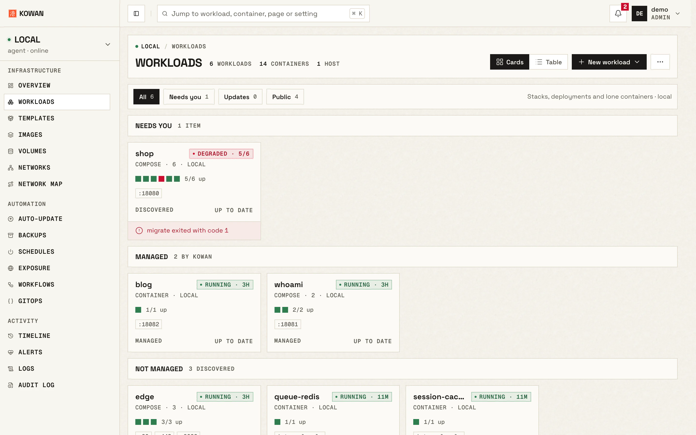

<p align="center">
  
</p>

<h1 align="center">Kowan</h1>

<p align="center">
  A light, self-hosted Docker manager for homelabs and small teams.<br>
  One server, an agent per host, a fast web UI, a CLI and an MCP server.
</p>

<p align="center">
  <a href="https://kowan-lab.github.io/kowan">Website</a> ·
  <a href="#quick-start">Quick start</a> ·
  <a href="docs/">Docs</a> ·
  <a href="https://github.com/kowan-lab/kowan/discussions">Discussions</a>
</p>

<p align="center">
  <a href="https://github.com/kowan-lab/kowan/actions/workflows/ci.yml"></a>
  <a href="LICENSE"></a>
</p>

<picture>
  <source media="(prefers-color-scheme: dark)" srcset="site/img/workloads-dark.webp">
  
</picture>

> The name comes from the Japanese 港湾 (*kōwan*): a harbour and its port facilities, where containers are loaded, stored and shipped.

## Features

- **Containers, images, volumes, networks and stacks** across all your hosts, with live logs, a web console and a file browser inside containers.
- **Compose deployments** with validation before you deploy, from an editor, a template or a git repository; every change is a revision you can diff and roll back.
- **Preview environments** for branches and pull requests, and **promotion** from staging to production of exactly what was tested.
- **Import** stacks from Portainer or from a folder of compose files.
- **Safe updates**: image vulnerability scans with Trivy, auto-update policies with maintenance windows, and automatic rollback when a new version fails its health check.
- **Self-update with rollback** for the server and every agent.
- **Exposure and HTTPS**: see what is published to the internet and expose services through Traefik with certificates.
- **Network map** of containers, networks, published ports and domains.
- **Volume backups** with restic to local disk, S3 or SFTP, with browsing and restore.
- **Scheduled start and stop** for containers and stacks.
- **GitOps**: export your configuration to git and sync it back with a reviewed diff.
- **Workflows and webhooks** to automate redeploys and maintenance.
- **Teams and resource-scoped permissions**, SSO with OpenID Connect, API keys and an audit log.
- **Alerts** by email and chat channels, and a daily or weekly **digest** of updates, vulnerabilities, failed backups and expiring certificates.
- **Uptime checks** for URLs and ports, with an optional public status page.
- **Retained, searchable logs** per workload across hosts, and **resource history** with a warning when memory keeps growing.
- **Guided disk cleanup** with size estimates, on demand or on a schedule.
- **Works on a phone** and installs as an app.
- **MCP server** so Claude and other AI assistants can inspect and operate your hosts with an API key's permissions.
- **Light and fast**: a small Python server with SQLite and no external database, a UI that updates from Docker events, and six built-in themes.

## Quick start

Run the server on a machine with Docker:

```bash
docker run -d --name kowan --restart unless-stopped \
  -p 5081:5081 \
  -v kowan-data:/data \
  -v /var/run/docker.sock:/var/run/docker.sock \
  ghcr.io/kowan-lab/kowan:latest
```

Open http://localhost:5081 and create the admin account. The first-run screen asks for a one-time setup token: the server prints it in its log (`docker logs kowan`). The local Docker host is ready to manage.

Prefer Compose? Download [docker-compose.yml](docker-compose.yml) and run `docker compose up -d`.

> Mounting the Docker socket gives Kowan root-equivalent control of the host. Put the server behind HTTPS before exposing it beyond your network.

### Add more hosts

In **Hosts → Add host**, Kowan shows a one-line `docker run` command for the agent. Two connection modes are available:

- **Edge:** the agent dials the server. Use it for hosts behind NAT or a firewall.
- **Direct:** the server dials the agent. Use it when the server can reach the host.

Admins can rename any host, the local one included, from its page, the Hosts list or `kowanctl hosts rename`. Only the displayed name changes: deployments, permissions and history stay attached to the host.

### Configuration

The server works without configuration. These environment variables are the ones you are most likely to set:

| Variable | Purpose |
|---|---|
| `KOWAN_EXTERNAL_URL` | The URL users and agents reach the server at. Needed for remote agents and SSO. |
| `KOWAN_ADMIN_USER`, `KOWAN_ADMIN_PASSWORD` | Create the first admin without the setup screen. |
| `KOWAN_SECRET_KEY` | Key that encrypts stored secrets. Generated and kept in `/data` when unset. |
| `KOWAN_JWT_SECRET` | Session signing key. Generated and kept in `/data` when unset. |
| `KOWAN_SETUP_TOKEN` | One-time token for the first-run setup screen. Generated and printed in the log when unset. |
| `KOWAN_RELEASE_REPOSITORY` | Where the server looks for new releases to announce in the bell. `ghcr.io/kowan-lab/kowan` by default; empty turns it off. |

Security settings, all optional. Admins can also narrow the two allowlists from **Settings > Network access** (never widen them, and never in a way that locks out their own connection):

| Variable | Purpose |
|---|---|
| `KOWAN_UI_ALLOW_CIDRS` | Addresses or CIDRs allowed to reach the web UI, the API and MCP, comma-separated. Webhooks and `/health` stay open. |
| `KOWAN_EDGE_ALLOW_CIDRS` | Addresses allowed to connect edge agents to the server. |
| `KOWAN_AGENT_ALLOW_CIDRS` | Set on an agent in direct mode: addresses allowed to connect to it (the server's). |
| `KOWAN_TRUSTED_PROXIES` | Reverse proxies allowed to state the client's address. From anyone else the header is ignored. |
| `KOWAN_PROXY_HEADER` | The header those proxies use: `X-Forwarded-For` (default) or `X-Real-IP`. |
| `KOWAN_SERVER_SCRIPTS` | `off` disables workflow script steps, which run bash on the server. Only admins can create them. |

Back up the `/data` volume: it holds the database and the keys.

## CLI and AI assistants

`kowanctl` controls the server from a terminal:

```bash
pip install git+https://github.com/kowan-lab/kowan
kowanctl --server https://kowan.example.com login
kowanctl hosts list
```

The built-in MCP server is described in [docs/mcp.md](docs/mcp.md). The **AI assistants** page in the UI shows ready-to-paste setups for Claude Code, Claude Desktop and Cursor.

## Documentation

- [Architecture](docs/architecture.md)
- [Updates and rollback](docs/updates-design.md)
- [Vulnerability scanning](docs/scanning.md)
- [Exposure and HTTPS](docs/exposure.md)
- [Volume backups](docs/volume-backups.md)
- [GitOps](docs/gitops.md), [compose validation](docs/compose-lint.md), [container labels](docs/labels.md), [scheduled start/stop](docs/schedules.md)
- [Deployment history](docs/deployment-history.md), [previews and promotion](docs/previews-and-promotion.md), [import](docs/import.md)
- [Uptime](docs/uptime.md), [retained logs](docs/retained-logs.md), [resource history](docs/resource-history.md)
- [Disk cleanup](docs/disk-cleanup.md), [the digest](docs/digest.md), [phone and installed app](docs/mobile-pwa.md)
- [Testing](docs/testing.md)
- [Permissions](docs/permissions.md) and [SSO](docs/sso.md)
- [MCP server](docs/mcp.md)
- [Connections](docs/connections.md), typed credentials shared across services
- [Changelog](docs/CHANGELOG.md)

## Contributing

Issues and pull requests are welcome. Start with [CONTRIBUTING.md](CONTRIBUTING.md). Report security issues privately as described in [SECURITY.md](SECURITY.md).

## License

[MIT](LICENSE)
